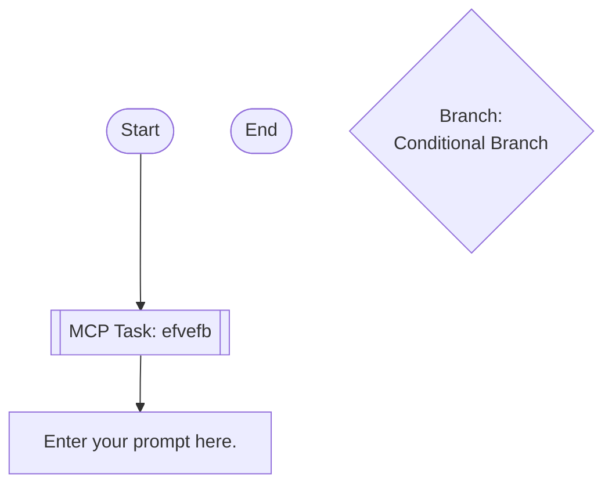

## Workflow Execution Guide

Follow the Mermaid flowchart above to execute the workflow. Each node type has specific execution methods as described below.

### Execution Methods by Node Type

- **Rectangle nodes (Sub-Agent: ...)**: Execute Sub-Agents
- **Diamond nodes (AskUserQuestion:...)**: Use the AskUserQuestion tool to prompt the user and branch based on their response
- **Diamond nodes (Branch/Switch:...)**: Automatically branch based on the results of previous processing (see details section)
- **Rectangle nodes (Prompt nodes)**: Execute the prompts described in the details section below

## MCP Tool Nodes

#### mcp_1772644665331(MCP Auto-Selection) - AI Tool Selection Mode

<!-- MCP_NODE_METADATA: {"mode":"aiToolSelection","serverId":"claude.ai Vercel","userIntent":"efvefb"} -->

**MCP Server**: claude.ai Vercel

**Validation Status**: valid

**User Intent (Natural Language Task Description)**:

```
efvefb
```

**Execution Method**:

Claude Code should analyze the task description above and query the MCP server "claude.ai Vercel" at runtime to get the current list of tools. Then, select the most appropriate tool and determine the appropriate parameter values based on the task requirements.

### Prompt Node Details

#### prompt_1772644771811(Enter your prompt here.)

```
Enter your prompt here.

You can use variables like {{variableName}}.
```

### Branch Node Details

#### branch_1772644686466(Binary Branch)

**Branch conditions:**
- **True**: When condition is true
- **False**: When condition is false

**Execution method**: Evaluate the results of the previous processing and automatically select the appropriate branch based on the conditions above.
